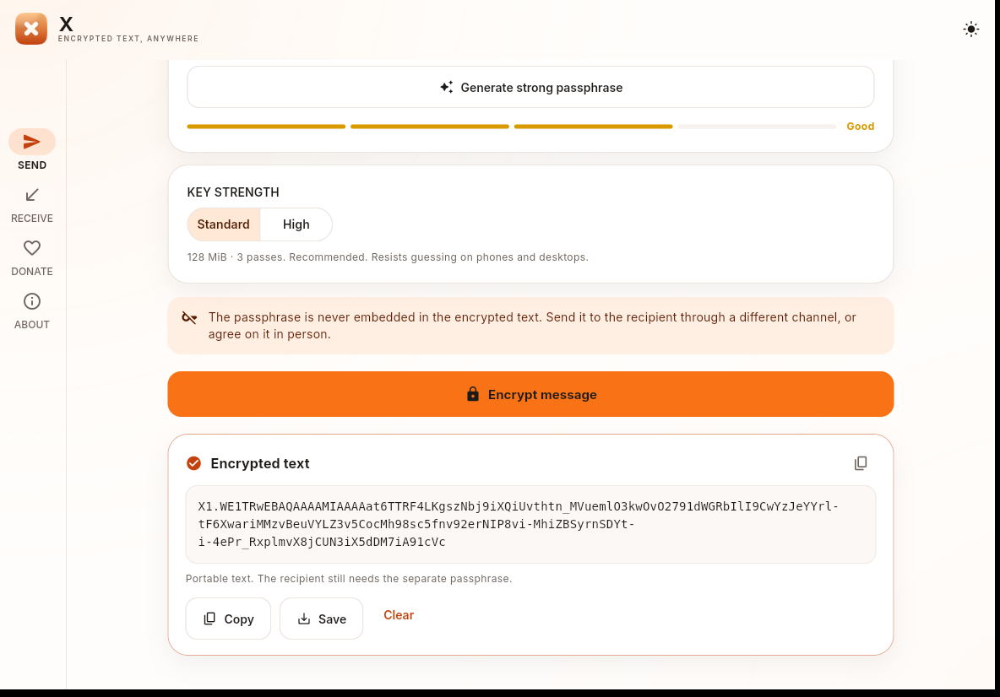
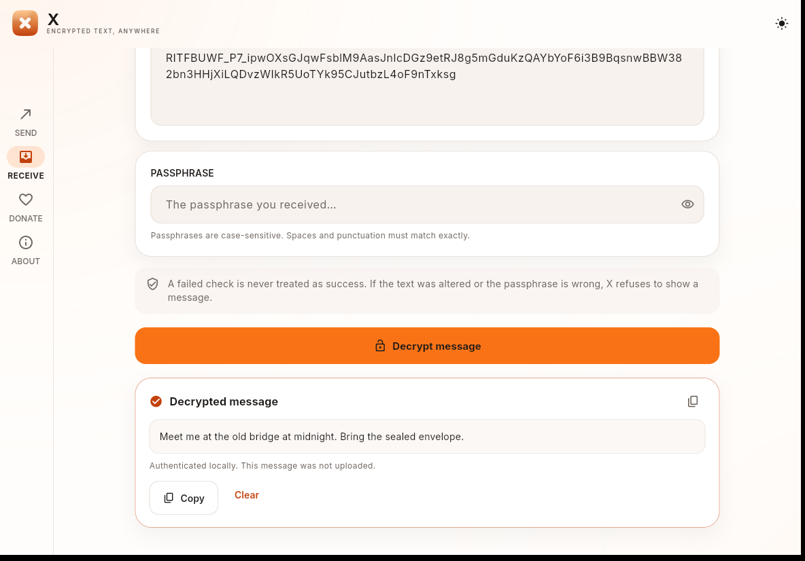
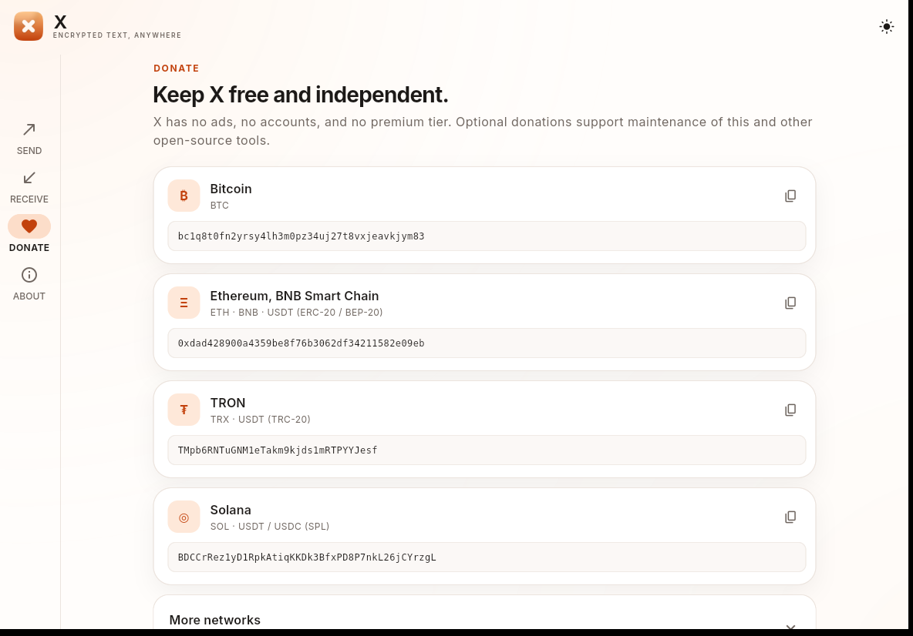
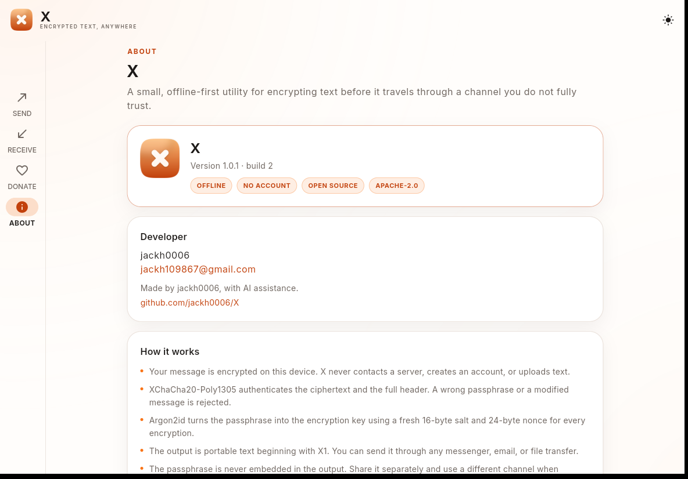

<p align="center">
  
</p>

<h1 align="center">X</h1>

<p align="center">
  <strong>Encrypt privately. Share freely. Decrypt anywhere.</strong><br>
  An offline-first encrypted text utility for Ubuntu and Android.
</p>

<p align="center">
  <a href="https://github.com/jackh0006/X/actions/workflows/ci.yml"></a>
  <a href="https://github.com/jackh0006/X/releases/latest"></a>
  <a href="LICENSE"></a>
  
  
</p>

---

X seals a piece of text with a passphrase and gives you portable ciphertext that
you can send through **any** channel — an existing messenger, email, a forum, a
USB stick. No account. No server. No registration. No telemetry. The recipient
opens it in X on Ubuntu or Android with the passphrase you shared separately.

## Why X?

Sometimes you need to send something sensitive through a channel you do not
trust with the plaintext. Creating an account on a messaging platform may not be
possible or desirable, and the other side may not use the same app.

X solves the narrow problem:

- **Encrypts locally.** The plaintext never reaches a server.
- **Makes portable ciphertext.** The output is text starting with `X1.` and can
  travel through anything.
- **Needs no account or registration.** There is nobody to sign up with.
- **Needs no X-operated server.** Encryption and decryption are entirely local.
- **Uses your existing messengers.** You choose the transport.
- **Works across platforms.** Encrypt on Ubuntu, decrypt on Android — or reverse.
- **Puts the encryption phrase in your hands.** X never embeds it or stores it, and can display it as an offline QR for separate sharing.
- **Is open source and inspectable.** Apache-2.0, reproducible build steps and a
  public threat model.

## New in v1.1.3

- **Encryption phrase QR:** display the phrase as an offline QR for sharing on a
  second device. No camera permission. Android blocks screenshots while the QR
  is visible.
- **Local Data panel:** view app data, cache and preferences paths; copy or open
  them; delete local app data; change the default export folder and filename.
- **One icon:** Linux now uses the Android icon artwork as its single source.
- **APK v2 and v3 signing** in addition to v2.
- Expanded tests for exact Unicode phrases, maximum-length phrases, FFI input
  validation, QR, and storage.

## Screenshots

All screenshots are from the real packaged Linux build, including a real
encryption and a real decryption.

| SEND | RECEIVE |
|---|---|
|  |  |

| DONATE | LOCAL DATA |
|---|---|
|  |  |

## Download

| Platform | Artifact | Requirements |
|---|---|---|
| Android | [`X-android-arm64.apk`](https://github.com/jackh0006/X/releases/latest/download/X-android-arm64.apk) | arm64-v8a, Android 7.0+ |
| Ubuntu | [`X-linux-amd64.deb`](https://github.com/jackh0006/X/releases/latest/download/X-linux-amd64.deb) | Ubuntu 24.04 amd64 (tested) |

Each release also includes `SHA256SUMS`, a CycloneDX SBOM, test results and a
self-assessment. Verify the checksum and the APK signing certificate before
installing. See [`INSTALLATION.md`](INSTALLATION.md).

### Android

```text
1. Download X-android-arm64.apk
2. Verify its SHA-256 against SHA256SUMS
3. Allow installation from your file manager for this one APK
4. Open X
```

Google Play Protect may show an “unknown app” warning for a sideloaded,
self-signed APK. That warning cannot be removed by application code. Verify the
checksum and certificate fingerprint, choose “Install anyway,” or distribute
through the Play Store. See [`docs/ANDROID_PLAY_PROTECT.md`](docs/ANDROID_PLAY_PROTECT.md).

### Ubuntu

```bash
sha256sum X-linux-amd64.deb
sudo apt install ./X-linux-amd64.deb
x
```

## How it works

### SEND

1. Write or paste a message (up to 64 KiB).
2. Enter a strong passphrase or generate a 7-word one.
3. Choose **Standard** (128 MiB, 3 passes) or **High** (256 MiB, 4 passes).
4. Encrypt locally.
5. Copy, share (Android), or save the `X1.…` ciphertext.
6. Send the passphrase **separately** — it is never in the payload.

### RECEIVE

1. Paste the `X1.…` text.
2. Enter the passphrase you received separately.
3. X validates the format, derives the key, verifies the tag and only then shows
   the plaintext.
4. Copy the message. Nothing is uploaded.

A wrong passphrase, modified ciphertext, or malformed envelope never produces a
successful-looking result.

## Cryptography at a glance

| Property | X |
|---|---|
| AEAD | XChaCha20-Poly1305-IETF (libsodium 1.0.22) |
| KDF | Argon2id v1.3, 16-byte salt, 128/256 MiB profiles |
| Nonce | 24 random bytes per encryption |
| Integrity | Poly1305 tag + full 55-byte header authenticated as AAD |
| Randomness | OS CSPRNG via libsodium |
| Format | Versioned `X1.` Base64URL, strict parser, hard size/KDF caps |
| Passphrase | 8–1024 bytes; 7-word EFF generator (~90 bits); never embedded |

Read the full specification in [`CRYPTOGRAPHY.md`](CRYPTOGRAPHY.md) and the
[`payload format`](docs/FORMAT.md). The Argon2id and XChaCha20 implementations
are cross-checked in tests against independent RustCrypto implementations.

## Privacy by construction

- **No Internet permission** in the Android release manifest.
- **No account, server, telemetry, analytics, ads, or crash reporting.**
- **No passphrase or plaintext logging.**
- **No passphrase persistence.**
- Android backup is disabled; no temporary plaintext files are created.
- The only locally stored preference is the theme.

See [`PRIVACY.md`](PRIVACY.md).

## Test results

Summary as of v1.1.3 (full evidence in
[`docs/TEST_RESULTS.md`](docs/TEST_RESULTS.md)):

| Area | Result |
|---|---|
| Rust core tests (crypto, parser, limits, FFI) | **34 / 34 PASS** |
| Flutter widget + native FFI tests | **17 / 17 PASS**, 80.9% line coverage |
| Algorithm cross-checks vs RustCrypto / `argon2` | **PASS** |
| Parser fuzzing | **18,418,323 runs, no crash** |
| clippy / fmt / `cargo audit` / `cargo deny` | **PASS** |
| CI incl. gitleaks, CodeQL, dependency review | **PASS** |
| APK build, signature, arm64 core | **PASS** |
| DEB build, metadata, extraction, launch | **PASS** |
| Android emulator + cross-platform | **PASS** (CI run 42613468188) |
| Physical Android device runtime | **NOT TESTED** |
| System-wide `dpkg -i` | **NOT TESTED** (needs sudo) |

Passing tests is not an audit. X has **not** been independently audited or
formally verified.

## Performance

On an Intel Pentium G2030 (2 cores, 3.8 GiB RAM, Ubuntu 24.04):

| Operation | Standard (128 MiB) | High (256 MiB) |
|---|---:|---:|
| Encrypt/decrypt (KDF-dominated) | ≈ 470 ms | ≈ 1.24 s |
| 64 KiB message overhead | a few ms | a few ms |
| Linux startup to window | 1.36 s | — |
| Linux max RSS | ~180 MiB | — |

Artifacts: **17.7 MiB APK**, **8.3 MiB DEB**, **26 MiB installed Linux bundle**.
See [`docs/PERFORMANCE_BENCHMARKS.md`](docs/PERFORMANCE_BENCHMARKS.md).

## Compatibility

- **Ubuntu 24.04.5 LTS amd64** — built, packaged, extracted and launched.
- **Android arm64-v8a** — release APK built and signature-verified; Linux and Android interoperability is exercised by CI; physical-device testing remains external.
- Ubuntu 22.04/25.04 and physical Android phones are **not claimed as tested**.
- Details: [`docs/COMPATIBILITY.md`](docs/COMPATIBILITY.md).

## How X compares

X is not a messenger. It does not provide accounts, transport, groups, calls or
metadata protection. Compared with standalone encryption tools, its advantages
are a small cross-platform GUI, no key management, and one portable format.
See the careful, category-separated comparison in
[`docs/COMPARISON.md`](docs/COMPARISON.md).

## Donate

X is free, with no ads and no premium tier. Optional donations support
maintenance. These are public receiving addresses published by jackh0006;
verify the full address in two official locations before sending. Crypto
transfers are irreversible. **No private key or seed phrase is ever published.**

| Network / asset | Address |
|---|---|
| Bitcoin (BTC) | `bc1q8t0fn2yrsy4lh3m0pz34uj27t8vxjeavkjym83` |
| Ethereum / BNB / USDT (ERC-20, BEP-20) | `0xdad428900a4359be8f76b3062df34211582e09eb` |
| TRON / USDT (TRC-20) | `TMpb6RNTuGNM1eTakm9kjds1mRTPYYJesf` |
| Solana / USDT / USDC (SPL) | `BDCCrRez1yD1RpkAtiqKKDk3BfxPD8P7nkL26jCYrzgL` |
| Dogecoin (DOGE) | `D6ZdMQ7mHGGmuH9prpZ2zjpnG5Q3WVRDtC` |
| XRP | `rNUAhaATFLvosdu9m9M95bupRBtZ8eqpj9` |
| Toncoin (TON) | `UQCu6-3yGyQ5dzvcCxr2gobuvx5ddbS9EC690qtey92P5_wX` |
| Litecoin (LTC) | `ltc1q2gs89cfy3mumr7gu9w0zl9rllf80q67m5rmma8` |

Validation evidence: [`docs/DONATIONS.md`](docs/DONATIONS.md).

## Build and contribute

```bash
# Ubuntu
./scripts/build-linux.sh
./scripts/build-deb.sh

# Android (arm64-v8a)
export ANDROID_NDK_HOME="$HOME/Android/Sdk/ndk/28.2.13676358"
./scripts/build-android.sh
```

See [`BUILDING.md`](BUILDING.md), [`TESTING.md`](TESTING.md) and
[`CONTRIBUTING.md`](CONTRIBUTING.md). Security reports go to
**jackh109867@gmail.com** per [`SECURITY.md`](SECURITY.md).

## Security honesty

X provides authenticated encryption with a memory-hard KDF, but it is not a
complete anonymity or messaging solution. It has:

- no forward secrecy,
- no sender identity,
- no replay protection,
- no metadata protection,
- no independent audit.

Those limits are explained in [`THREAT_MODEL.md`](THREAT_MODEL.md) and
[`docs/SECURITY_ASSESSMENT.md`](docs/SECURITY_ASSESSMENT.md). The evidence
checklist, no-remote-access proof, and incremental test policy are in
[`docs/CHECKLIST_100.md`](docs/CHECKLIST_100.md),
[`docs/NO_REMOTE_ACCESS.md`](docs/NO_REMOTE_ACCESS.md), and
[`docs/TEST_IMPACT.md`](docs/TEST_IMPACT.md). Real-world results are in
[`docs/REAL_WORLD_TESTS.md`](docs/REAL_WORLD_TESTS.md); backup guidance is in
[`docs/BACKUP.md`](docs/BACKUP.md). The strict scorecard and AI-access evidence are in
[`docs/SECURITY_SCORECARD.md`](docs/SECURITY_SCORECARD.md) and
[`docs/AI_ACCESS.md`](docs/AI_ACCESS.md). Use a strong,
unique passphrase and exchange it out of band.

## Developer

**jackh0006** · jackh109867@gmail.com

Made by jackh0006, with AI assistance.

Source: https://github.com/jackh0006/X

## License

Apache License 2.0. See [`LICENSE`](LICENSE) and [`NOTICE`](NOTICE).

<p align="center"><strong>Encrypt privately. Share freely. Decrypt anywhere.</strong></p>
